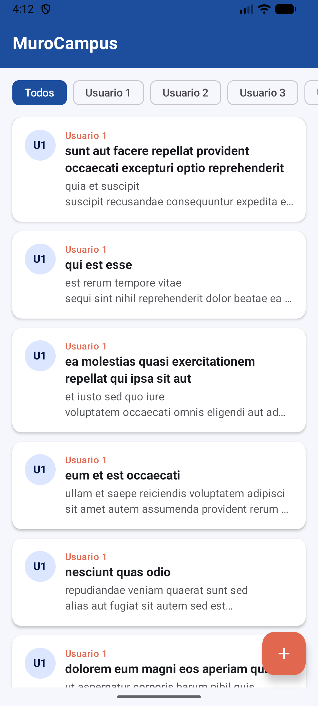
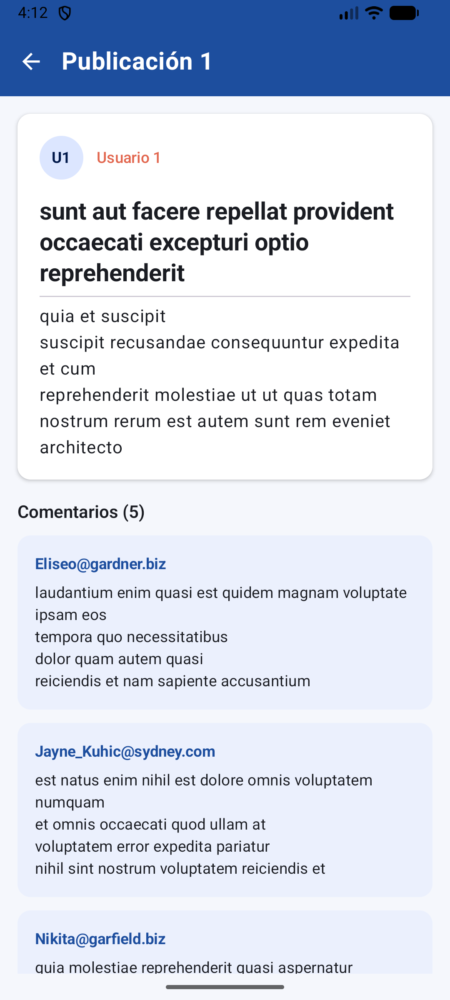
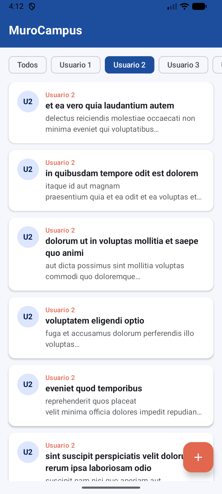
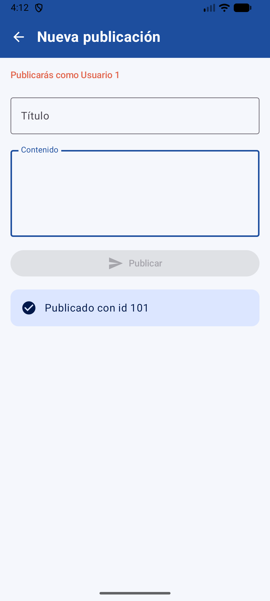
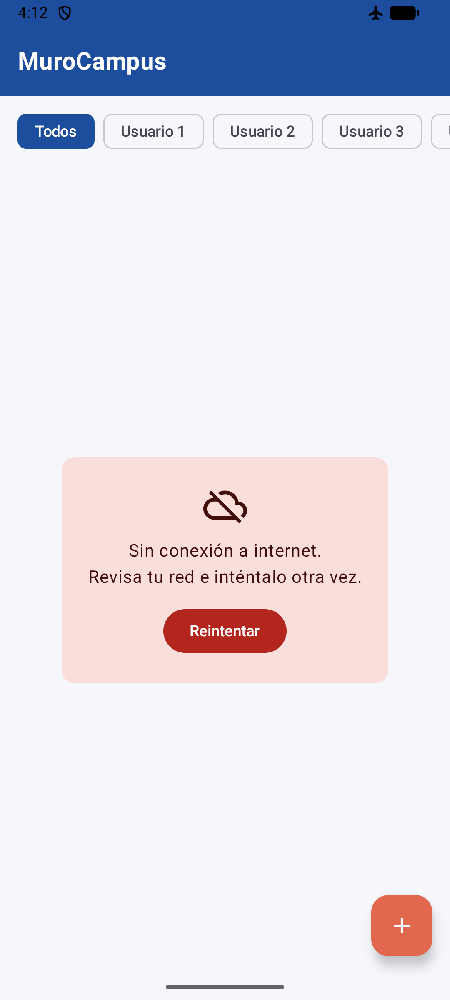

# MuroCampus – Semana 09

## Descripción
MuroCampus es una aplicación móvil desarrollada en Kotlin y Jetpack Compose que consume el servicio web REST de [JSONPlaceholder](https://jsonplaceholder.typicode.com/). Permite listar publicaciones, ver el detalle de cada una con sus comentarios, filtrarlas por usuario y crear una publicación nueva. Si no hay internet o el servidor falla, la app muestra un mensaje de error con la opción de reintentar en lugar de cerrarse.

> **Ramas:** la Fase 1 (sin IA) está en la rama `sin-ia` y la Fase 2 (con IA) en la rama `con-ia`, siguiendo la organización del repositorio del curso.

## Tecnologías utilizadas
- Kotlin
- Android Studio
- Jetpack Compose
- Material Design 3
- Retrofit 2.11
- OkHttp 4.12 + HttpLoggingInterceptor
- kotlinx.serialization
- Kotlin Coroutines y StateFlow
- Arquitectura MVVM + Repository

## Funcionalidades implementadas

### 1. Lista de publicaciones (`GET posts`)
- Descarga de las 100 publicaciones del servicio.
- Tarjetas con avatar, etiqueta "Usuario N", título en negrita y resumen de 2 líneas.
- Tres estados: Cargando, Éxito y Error con botón Reintentar.
- Al rotar la pantalla no se vuelve a descargar, porque el ViewModel conserva el estado.

### 2. Detalle con comentarios (`GET posts/{id}` y `GET posts/{id}/comments`)
- Título y texto completos de la publicación.
- Sección "Comentarios (N)" con el correo en azul y el texto de cada comentario.
- Las dos llamadas se hacen en paralelo con `async`. Si una falla, todo el detalle muestra el error.
- El botón Atrás (flecha o `BackHandler`) vuelve a la lista sin recargarla.

### 3. Filtro por usuario (`GET posts?userId=N`)
- Fila desplazable de chips: Todos y Usuario 1 a Usuario 10.
- El chip activo se ve relleno.
- Si el filtro devuelve una lista vacía, se muestra "Sin publicaciones".

### 4. Crear publicación (`POST posts` con `@Body`)
- Botón flotante **+** en la lista.
- Formulario con Título y Contenido. Publicar está deshabilitado si algún campo está vacío.
- Muestra "Publicado con id 101" y limpia el formulario.
- Si falla, muestra el error y conserva lo escrito para reintentar.

### 5. Manejo de errores
| Excepción | Mensaje en pantalla |
|---|---|
| `IOException` | Sin conexión a internet. Revisa tu red e inténtalo otra vez. |
| `HttpException` | Error del servidor (código) |
| `SerializationException` | Respuesta inesperada |
| Otra | Error desconocido |

## Estructura de paquetes

```
com.abad.murocampus/
├── MainActivity.kt              Crea el ViewModel y decide qué pantalla mostrar
├── model/
│   └── Modelos.kt               Post, Comentario y NuevoPost (@Serializable)
├── data/
│   ├── remote/
│   │   ├── PostApi.kt           Interface de Retrofit (@GET, @POST, @Path, @Query, @Body)
│   │   └── RetrofitClient.kt    Cliente único con OkHttp y conversor JSON
│   ├── PostRepository.kt        Interface + PostRepositoryRemote (devuelve Result)
│   └── MensajesError.kt         Convierte cada excepción en un mensaje
├── viewmodel/
│   ├── UiState.kt               Cargando / Exito / Error
│   ├── PostsViewModel.kt        Lista, detalle, filtro y crear
│   └── PostsViewModelFactory.kt Entrega el Repository al ViewModel
└── ui/
    ├── Componentes.kt           TarjetaPost, AvatarUsuario, Cargando, ErrorConReintento
    ├── PantallaLista.kt
    ├── PantallaDetalle.kt
    ├── PantallaCrear.kt
    └── theme/                   Colores, tipografía y tema Material 3
```

## Arquitectura MVVM + Repository

```
 View (PantallaLista, PantallaDetalle, PantallaCrear)
   │  eventos: cargar, abrir, filtrar, publicar        ▲ collectAsStateWithLifecycle()
   ▼                                                   │
 ViewModel (PostsViewModel) ── StateFlow<UiState> (Cargando / Exito / Error)
   │  viewModelScope.launch
   ▼
 PostRepository (interface)  ◄── devuelve Result<...>
   │
   └─► PostRepositoryRemote (captura las excepciones y las convierte en Result.failure)
         │
         ▼
 PostApi (Retrofit) ── OkHttp ──► https://jsonplaceholder.typicode.com/
```

| Capa | Conoce a | No debe |
|---|---|---|
| View (`ui/`) | Solo a su ViewModel | Llamar a Retrofit ni a la API |
| ViewModel | Solo a la interface `PostRepository` | Usar Retrofit, `PostApi`, `HttpException` ni `Context` |
| Repository | `PostApi` y las excepciones de red | Conocer la UI ni dejar escapar excepciones |
| `data/remote` | Retrofit, OkHttp y el JSON | Guardar estado de pantalla |

> La función `mensajeDe()` está en `data/` y no en `viewmodel/`, porque usa `HttpException` y esa clase no debe aparecer en el ViewModel.

## Capturas

| Lista | Detalle | Filtro (Usuario 2) |
|---|---|---|
|  |  |  |

| Crear publicación | Error de conexión |
|---|---|
|  |  |

## Pruebas realizadas

| Prueba | Cómo se provocó | Resultado obtenido | OK |
|---|---|---|---|
| Sin internet | Modo avión y abrir la app | "Sin conexión a internet" y botón Reintentar | ✅ |
| Reintentar | Quitar el modo avión y pulsar Reintentar | Carga la lista | ✅ |
| Recurso inexistente | Cambiar temporalmente el detalle a `posts/9999` | "Error del servidor (404)" | ✅ |
| JSON inesperado | Quitar temporalmente `name` de `Comentario` | Funciona, gracias a `ignoreUnknownKeys` | ✅ |
| JSON inesperado | Agregar temporalmente un campo `likes` que no llega | "Respuesta inesperada" | ✅ |
| Cancelación | Abrir el detalle y volver rápido 5 veces | Sin errores en Logcat | ✅ |
| Lista y detalle | Abrir las publicaciones 1, 2 y 3 | Siempre 5 comentarios | ✅ |
| Filtro | Elegir Usuario 1 a Usuario 10 | Siempre 10 publicaciones (`posts?userId=N`) | ✅ |
| Crear | Enviar una publicación | "Publicado con id 101" (respuesta 201) | ✅ |
| Código | Buscar en `viewmodel/` | No hay Retrofit, `PostApi` ni `HttpException` | ✅ |

Los cambios temporales de las pruebas se deshicieron antes del commit.

## Para pensar

**1. ¿Qué diferencia hay entre GET y POST? ¿Por qué crear lleva `@Body` y porUsuario lleva `@Query`?**
GET solo lee información del servidor y no envía cuerpo; POST envía datos para crear un recurso nuevo. `crear` necesita mandar un objeto completo (`NuevoPost`), así que lo envía como JSON dentro del cuerpo con `@Body`. `porUsuario` no crea nada: lee la misma lista de `posts`, pero filtrada, por eso el filtro va en la URL como parámetro (`posts?userId=2`) con `@Query`.

**2. ¿Por qué la ruta es `"posts"` y no `"/posts"`?**
Porque Retrofit une la ruta con la `baseUrl`. Si la ruta empieza con `/`, se toma como absoluta y reemplaza todo el camino que tenga la URL base después del dominio. Sin la barra, la ruta se agrega al final de `https://jsonplaceholder.typicode.com/`, y por eso la URL base debe terminar en `/`.

**3. ¿Por qué el Repository devuelve `Result` en vez de dejar que la excepción llegue al ViewModel?**
Para que el ViewModel no tenga que conocer los errores de red ni Retrofit. El Repository captura todas las excepciones y las convierte en `Result.failure`, y el ViewModel solo decide qué estado mostrar con `onSuccess` y `onFailure`. Así ninguna excepción cierra la app, y se podría cambiar la fuente de datos (por ejemplo, a Room) sin tocar el ViewModel ni las pantallas. La única excepción que se vuelve a lanzar es `CancellationException`, para que las corrutinas se cancelen bien.

**4. ¿Qué pasa si olvidas el permiso INTERNET? ¿Y si olvidas `ignoreUnknownKeys` y el servidor agrega un campo nuevo?**
Sin el permiso INTERNET la app compila, pero cada llamada falla con un error de red, aunque el teléfono sí tenga conexión, y la pantalla mostraría el error. Sin `ignoreUnknownKeys`, si el servidor agrega un campo que la `data class` no tiene, kotlinx.serialization lanza `SerializationException` y la app mostraría "Respuesta inesperada" en todas las pantallas.

**5. ¿Por qué la pantalla de lista usa un `when` sobre `UiState` y no un `if` con tres variables?**
Porque `UiState` es una `sealed interface`: la pantalla solo puede estar en uno de los tres estados a la vez, y el compilador obliga a dibujar los tres casos en el `when`. Con tres variables sueltas (`cargando`, `error`, `datos`) se podrían dar combinaciones imposibles, como estar cargando y con error al mismo tiempo, y habría que acordarse de actualizar las tres cada vez.

**6. JSONPlaceholder no guarda los POST. ¿Cómo cambiaría tu app si usaras un servicio real?**
Al publicar, la nueva publicación sí quedaría guardada, así que después de crearla habría que volver a cargar la lista o agregar a la lista local el `Post` que devuelve el servidor, para que aparezca sin recargar. También haría falta autenticación (por ejemplo, un token en un encabezado), el `userId` sería el del usuario que inició sesión y no un 1 fijo, y habría que manejar errores de validación que el servidor devuelva, como 400 o 401.
