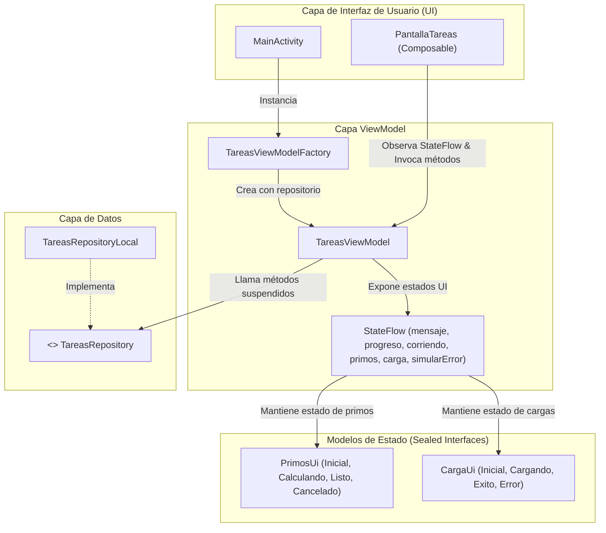
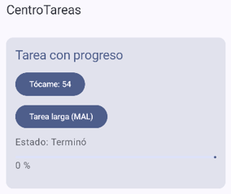
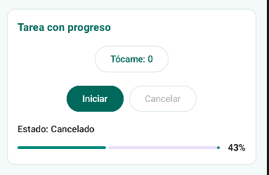
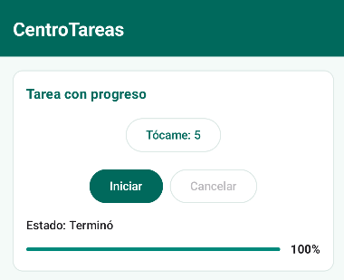
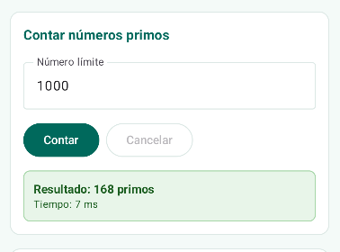
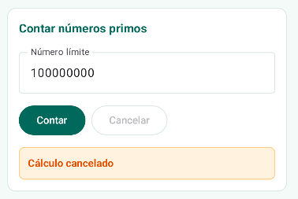
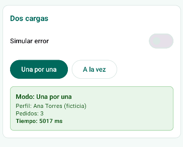
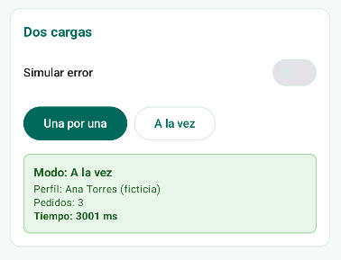
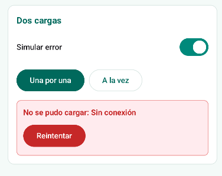

# CentroTareas - Laboratorio de Corrutinas en Android (Fase 1)

## 1. Información General
- **Nombre del proyecto**: CentroTareas
- **Descripción**: Aplicación interactiva de Android desarrollada para el laboratorio de la Semana 14 (Fase 1). Su objetivo es analizar, implementar y comparar el manejo de tareas asíncronas, la congelación de la pantalla por bloqueo del hilo principal y la concurrencia eficiente utilizando Corrutinas en Kotlin y Jetpack Compose.
- **Tecnologías utilizadas**:
  - **Lenguaje**: Kotlin
  - **UI Toolkit**: Jetpack Compose (Material 3)
  - **Librerías principales**: Kotlin Coroutines (`viewModelScope`, `Job`, `StateFlow`, `Dispatchers.Default`, `async`/`await`)
  - **Arquitectura**: MVVM (Model-View-ViewModel)
  - **Entorno de desarrollo**: Android Studio & Gradle

---

## 2. Estructura del Proyecto
Árbol real de paquetes y archivos del proyecto `com.abad.centrotareas`:

```text
com.abad.centrotareas
├── MainActivity.kt
├── data
│   ├── TareasRepository.kt
│   └── TareasRepositoryLocal.kt
├── model
│   └── Estados.kt
├── ui
│   ├── PantallaTareas.kt
│   └── theme
│       ├── Color.kt
│       ├── Theme.kt
│       └── Type.kt
└── viewmodel
    ├── TareasViewModel.kt
    └── TareasViewModelFactory.kt
```

---

## 3. Arquitectura MVVM
El siguiente diagrama en Mermaid ilustra la separación de capas en la arquitectura MVVM y el flujo de comunicación entre la UI (`PantallaTareas`), el ViewModel (`TareasViewModel`), los modelos de estado y la capa de datos (`TareasRepositoryLocal`):



---

## 4. Funcionalidades Implementadas

| Funcionalidad | Descripción Técnica |
| :--- | :--- |
| **Tarea larga (MAL) y bloqueo del hilo principal** | Ejecuta `Thread.sleep(4000)` en el hilo principal (`Main Thread`), demostrando el congelamiento total de la interfaz del usuario y la imposibilidad de procesar recomposiciones ni toques. |
| **Tarea con corrutinas y progreso** | Ejecuta un bucle asíncrono con `delay(40)` dentro de `viewModelScope.launch`, actualizando el valor del progreso (`StateFlow<Float>`) de forma fluida sin congelar la UI. |
| **Cancelación mediante Job** | Almacena la referencia de la corrutina en una propiedad `Job?` y llama a `trabajo?.cancel()`, interrumpiendo el flujo de forma segura y actualizando el mensaje a `"Cancelado"`. |
| **Cálculo de números primos (Dispatchers.Default)** | Delega un cálculo matemático intensivo en el hilo de cómputo `Dispatchers.Default` utilizando `withContext(Dispatchers.Default)` y la verificación de cancelación activa con `ensureActive()`. |
| **Cancelación del cálculo de primos** | Cancela el objeto `primosJob?.cancel()`, capturando la excepción `CancellationException` para cambiar el estado UI a `PrimosUi.Cancelado`. |
| **Comparación de cargas secuenciales y paralelas** | Utiliza `async` / `await` dentro de un bloque `coroutineScope` para ejecutar dos llamadas suspendidas (`cargarPerfil` de 2s y `cargarPedidos` de 3s) simultáneamente, reduciendo el tiempo total de ~5s a ~3s. |
| **Simulación de errores y reintentos** | Controlado por el estado `simularError`. Cuando está activado, `cargarPedidos` lanza una excepción `IOException("Sin conexión")`, capturada para mostrar el estado `CargaUi.Error` y permitir reintentar con el botón dedicado. |

---

## Observación del Paso 1: Congelamiento de pantalla

Al presionar el botón "Tarea larga (MAL)", la aplicación deja de responder durante aproximadamente 4 segundos.

El mensaje "Trabajando..." no llega a visualizarse porque Thread.sleep(4000) bloquea el hilo principal e impide que Android actualice la interfaz mientras se ejecuta la espera.

Si la espera fuera de 10 segundos, Android podría mostrar un aviso de que la aplicación no responde (ANR), debido al bloqueo prolongado del hilo principal.

---

## 5. Evidencias de Funcionamiento

### 1. Tarea Larga Bloqueante (MAL)



*Muestra la congelación de la pantalla provocada por `Thread.sleep(4000)` en el hilo principal.*

### 2. Tarea Cancelada



*Muestra el estado "Cancelado" tras cancelar la ejecución del `Job` de la corrutina de progreso.*

### 3. Tarea Completada



*Muestra la barra de progreso completa al 100% y el mensaje "Terminó".*

### 4. Cálculo de Números Primos (N = 1000)



*Muestra el resultado del cómputo de 168 números primos en `Dispatchers.Default` y el tiempo transcurrido.*

### 5. Cálculo de Primos Cancelado



*Muestra la respuesta del sistema al presionar el botón "Cancelar" durante el cálculo pesado.*

### 6. Carga Secuencial (Una por una)



*Muestra el tiempo total (~5000 ms) correspondiente a sumar secuencialmente los 2s de perfil y los 3s de pedidos.*

### 7. Carga Paralela (A la vez)



*Muestra la optimización del tiempo (~3000 ms) al ejecutar ambas cargas en paralelo usando `async` / `await`.*

### 8. Error Simulado y Opción de Reintento



*Muestra el manejo de excepciones con la tarjeta de error roja y la opción de reintentar la operación.*

---

## 6. Preguntas para Pensar

### 1. ¿Por qué no se veía "Trabajando..." en el Paso 1?
Porque la llamada a `_mensaje.value = "Trabajando..."` actualiza el valor del estado en memoria, pero inmediatamente después la línea `Thread.sleep(4000)` detiene y bloquea por completo el hilo principal (`Main / UI Thread`). Como el hilo principal es responsable de procesar la cola de renderizado y dibujar los componentes de Compose en pantalla, la aplicación se congela sin realizar la recomposición gráfica. Al terminar los 4 segundos, el código avanza a `_mensaje.value = "Terminó"`, por lo que el estado intermedio jamás llega a dibujarse.

### 2. ¿Qué diferencia hay entre `Thread.sleep` y `delay`?
- **`Thread.sleep(ms)`**: Es una función bloqueante síncrona del lenguaje Java. Congela el hilo físico completo donde se ejecuta, impidiendo que procese cualquier otra tarea, evento de interfaz gráfica o dibujo en pantalla.
- **`delay(ms)`**: Es una función de suspensión propia de las Corrutinas de Kotlin (`suspend fun`). Suspende la ejecución de la corrutina actual pero libera el hilo físico subyacente para que pueda seguir realizando otros trabajos (como responder a toques del usuario o renderizar frames).

### 3. ¿Por qué `Dispatchers.Default` para los primos y `Dispatchers.IO` para la red?
- **`Dispatchers.Default`**: Está diseñado para tareas con alto consumo de CPU (cálculos matemáticos complejos, algoritmos intensivos). Su pool de hilos está acotado al número de núcleos físicos del procesador.
- **`Dispatchers.IO`**: Está optimizado para operaciones de entrada/salida (I/O) donde los hilos pasan la mayor parte del tiempo esperando respuestas externas (consultas a base de datos, peticiones HTTP de red, lectura/escritura en disco). Su pool de hilos es extensible (hasta 64 hilos o más) para no saturar los hilos de CPU mientras se espera respuesta del hardware o red.

### 4. ¿Qué pasaría con la corrutina si el usuario cierra la pantalla? ¿Qué papel cumple `viewModelScope`?
Si la corrutina fuera lanzada en un scope no administrado (como `GlobalScope`), la corrutina continuaría ejecutándose en segundo plano aunque la interfaz haya sido destruida, provocando **fugas de memoria** (*memory leaks*) y desperdicio de batería y CPU.

El uso de **`viewModelScope`** garantiza que la corrutina esté ligada al ciclo de vida del `TareasViewModel`. Cuando la pantalla se destruye y el ViewModel se limpia (`onCleared`), `viewModelScope` cancela automáticamente todas las corrutinas activas asociadas, liberando los recursos de forma transparente.

### 5. ¿Por qué `async` tarda 3 segundos y no 5? ¿Qué pasa si una de las dos cargas falla?
- **Tiempo de 3s vs 5s**: De forma secuencial, se ejecuta primero la función de 2s y al terminar la de 3s ($2 + 3 = 5\text{ s}$). Con `async`, ambas tareas se lanzan en paralelo al mismo tiempo dentro de un `coroutineScope`. El tiempo total de espera es el tiempo que tarde la tarea más larga: $\max(2\text{ s}, 3\text{ s}) = 3\text{ s}$.
- **Si una carga falla**: Por el principio de **Concurrencia Estructurada** en Kotlin, si una corrutina hija dentro de `coroutineScope` lanza una excepción (como `IOException`), esa excepción cancela la corrutina padre y propaga de inmediato la cancelación a las demás corrutinas hermanas en ejecución. El bloque `try-catch` en el ViewModel captura el error y actualiza la UI al estado `CargaUi.Error`.

---

## 7. Verificación de Compilación
Se ejecutó la tarea de compilación en Gradle para verificar la integridad del proyecto:

```bash
./gradlew app:assembleDebug
```

- **Resultado de la compilación**: `BUILD SUCCESSFUL` / `Build finished successfully`.
- El ejecutable `app-debug.apk` se generó correctamente sin ningún error de compilación.
