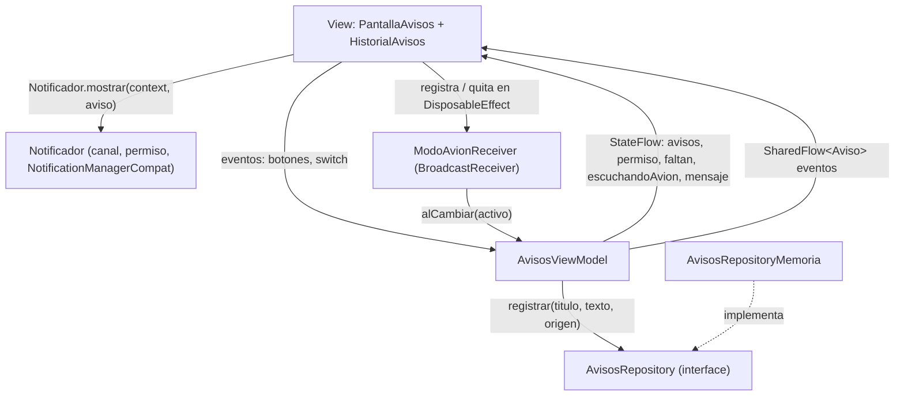
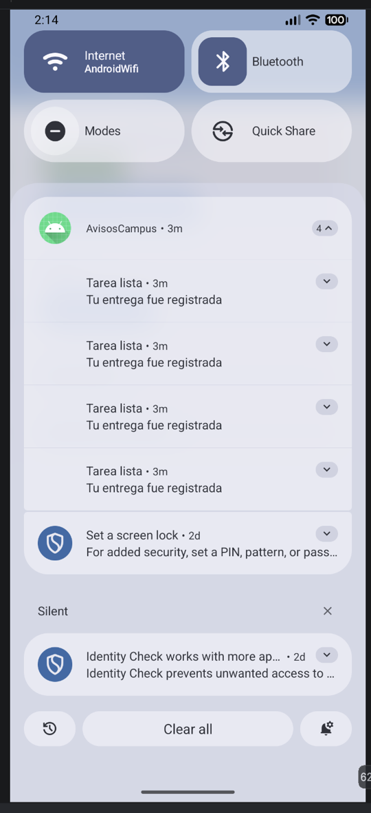
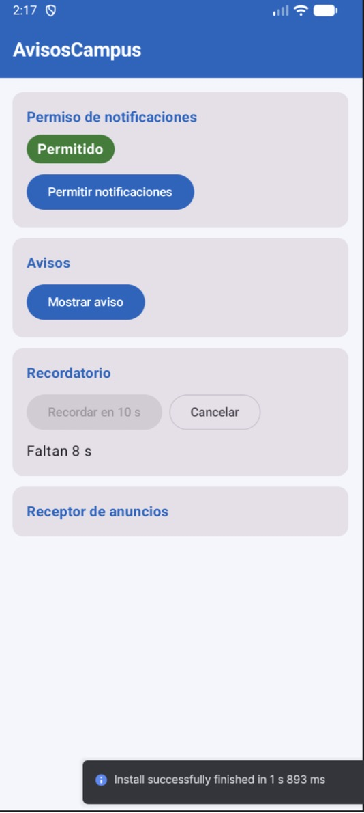
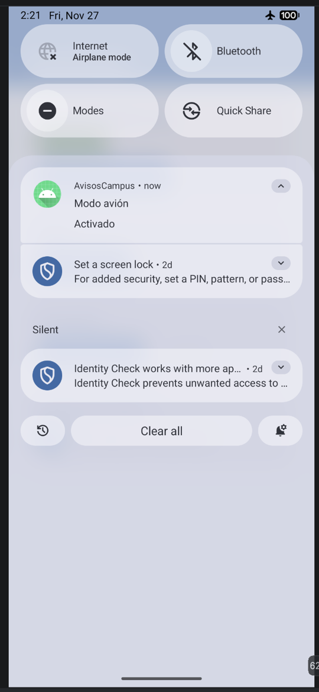
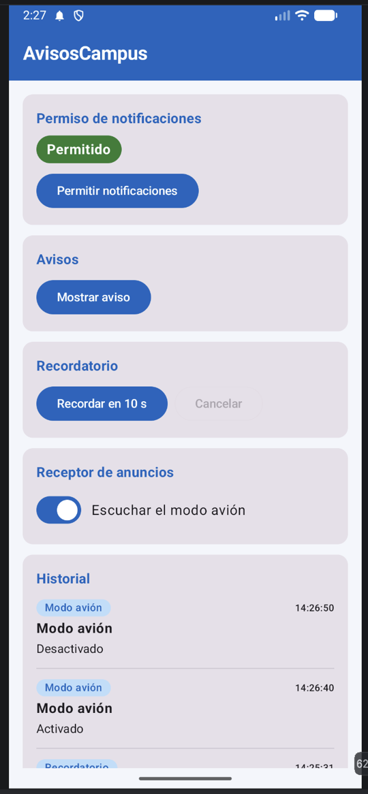
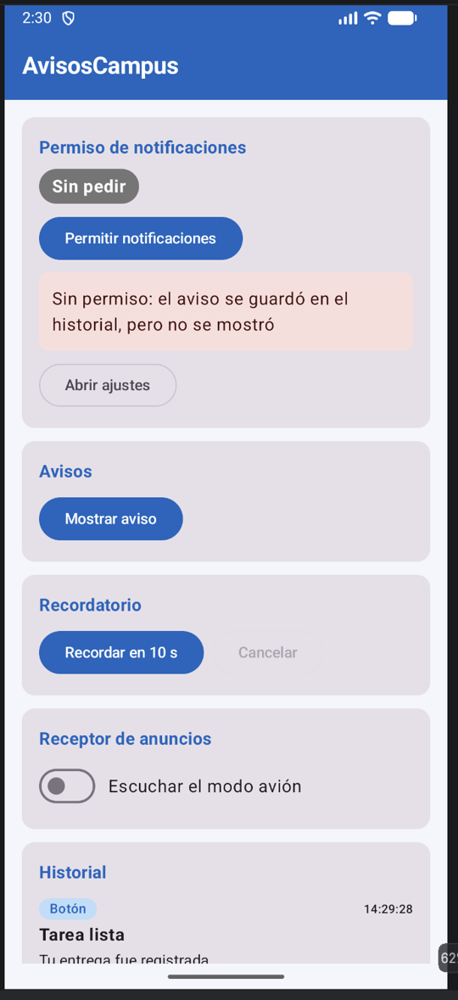

# AvisosCampus - Laboratorio de Notificaciones en Android (Semana 15 · Fase 1)

## 1. Información general
- **Nombre del proyecto**: AvisosCampus
- **Descripción**: App que muestra notificaciones locales y escucha lo que pasa en el celular. Con un botón muestra un aviso, con otro programa un recordatorio que llega a los 10 segundos (con cuenta regresiva y opción de cancelar) y puede avisar cuando se activa o desactiva el modo avión. Todo queda anotado en un historial. Si el usuario niega el permiso, la app sigue funcionando y ofrece abrir los ajustes.
- **Tecnologías**: Kotlin, Jetpack Compose + Material 3 (sin XML), `NotificationCompat`, `PendingIntent`, `BroadcastReceiver`, corrutinas (`viewModelScope`, `Job`, `delay`), `StateFlow` y `SharedFlow`.
- **Arquitectura**: MVVM + Repository (interface).
- **Requisito de prueba**: emulador con Android 13 o superior (API 33+).

---

## 2. Estructura de paquetes

```text
com.abad.avisoscampus
├── AvisosApp.kt                  Application: crea el canal "Avisos"
├── MainActivity.kt
├── model
│   └── Modelos.kt                Aviso, Origen, PermisoUi
├── data
│   └── AvisosRepository.kt       interface + AvisosRepositoryMemoria
├── notificacion
│   └── Notificador.kt            crearCanal, tienePermiso y mostrar
├── receiver
│   └── ModoAvionReceiver.kt      escucha ACTION_AIRPLANE_MODE_CHANGED
├── viewmodel
│   ├── AvisosViewModel.kt
│   └── AvisosViewModelFactory.kt
└── ui
    ├── PantallaAvisos.kt         tarjetas, permiso, receptor y eventos
    ├── HistorialAvisos.kt        lista de avisos (lo más reciente arriba)
    └── theme
        ├── Color.kt
        ├── Theme.kt
        └── Type.kt
```

---

## 3. Arquitectura MVVM + Repository



**Idea clave:** el ViewModel decide qué avisar, lo anota en el Repository y emite un evento. La pantalla (que sí tiene `Context`) recibe el evento y llama al `Notificador`. En `viewmodel/` no hay `Context`, `NotificationManager` ni `BroadcastReceiver`.

---

## 4. Funcionalidades

| Paso | Funcionalidad | Detalle técnico |
| :--- | :--- | :--- |
| 1 | Canal «Avisos» | `NotificationChannel("avisos", "Avisos", IMPORTANCE_DEFAULT)` creado en `AvisosApp.onCreate` |
| 2 | Permiso | `POST_NOTIFICATIONS` en el Manifest, `RequestPermission` en API 33+ y etiqueta Sin pedir / Permitido / Denegado |
| 3 | Notificación | `NotificationCompat.Builder` y `notify(aviso.id, ...)`: cada aviso tiene su propio id |
| 4 | Abrir la app | `PendingIntent.getActivity(..., FLAG_IMMUTABLE)` + `setAutoCancel(true)` |
| 5 | Recordatorio | Corrutina con `delay(1000)` en bucle, `Job` cancelable y `finally` que deja `faltan = null` |
| 6 | Modo avión | `ModoAvionReceiver` registrado con `RECEIVER_NOT_EXPORTED` en `DisposableEffect` y quitado en `onDispose` |
| 7 | Historial | `HistorialAvisos(avisos)` con `take(20)`, lo más reciente arriba |
| 8 | Permiso denegado | Mensaje de error, botón «Abrir ajustes» (`ACTION_APP_NOTIFICATION_SETTINGS`) y la app no se cierra |

---

## 5. Capturas

| Notificación en el panel | Recordatorio |
| :---: | :---: |
|  |  |

| Modo avión | Historial | Permiso denegado |
| :---: | :---: | :---: |
|  |  |  |

---

## 6. Pruebas de aceptación (Android 13+)

| Prueba | Resultado esperado | OK |
| :--- | :--- | :---: |
| Ajustes → Apps → AvisosCampus → Notificaciones | Existe el canal Avisos | ✅ |
| Pulsar Permitir notificaciones | Aparece el cuadro de Android y la etiqueta cambia | ✅ |
| Pulsar Mostrar aviso | Aparece la notificación Tarea lista | ✅ |
| Pulsar Mostrar aviso dos veces | Aparecen dos notificaciones distintas | ✅ |
| Tocar la notificación | Se abre la app y la notificación desaparece | ☐ |
| Recordar en 10 s | Cuenta regresiva y aviso al llegar a 0 | ✅ |
| Recordar y minimizar la app | El aviso llega igual | ☐ |
| Recordar y cancelar | No llega ningún aviso | ✅ |
| Switch activado y cambiar el modo avión | Aviso Activado y luego Desactivado | ✅ |
| Switch desactivado y cambiar el modo avión | No hay aviso | ☐ |
| Permiso denegado y Mostrar aviso | Mensaje de error, aviso en el historial y la app no se cierra | ✅ |
| Rotar la pantalla durante el recordatorio | La cuenta regresiva continúa | ☐ |
| Revisar el código | No hay Context en viewmodel/ y todo receptor registrado se quita en onDispose | ✅ |

---

## 7. Para pensar

**1. ¿Por qué una notificación necesita un canal y un permiso? ¿Qué pasa si falta cada uno?**
Desde Android 8 (API 26) toda notificación pertenece a un canal: el canal define la importancia (sonido, si aparece emergente) y permite que el usuario controle cada tipo de aviso por separado desde Ajustes. Si falta el canal, en Android 8+ la notificación no se muestra (el sistema la descarta y solo deja un aviso en el Logcat). Desde Android 13 (API 33) además se necesita el permiso `POST_NOTIFICATIONS`, para que el usuario decida si la app puede notificarle. Si falta el permiso (no está en el Manifest o el usuario lo negó), `notify` no muestra nada; por eso `Notificador.mostrar` lo revisa antes y devuelve `false`.

**2. ¿Por qué el ViewModel emite un evento y no muestra la notificación él mismo?**
Porque mostrar una notificación necesita un `Context` y el `NotificationManager`, y el ViewModel no debe tenerlos: vive más que la Activity (sobrevive a la rotación) y guardar un Context ahí puede filtrar memoria. Además, sin Android dentro, el ViewModel se puede probar con pruebas unitarias. El ViewModel solo decide qué avisar y lo registra; la pantalla, que sí tiene Context, recibe el evento por el `SharedFlow` y llama al `Notificador`. Se usa `SharedFlow` y no `StateFlow` porque es un evento de una sola vez: no debe repetirse al rotar.

**3. ¿Qué pasa si usas el mismo id en dos notificaciones?**
La segunda reemplaza a la primera: Android actualiza la notificación existente en lugar de agregar otra. Por eso se usa `aviso.id`, que el Repository incrementa en cada registro, y al pulsar dos veces aparecen dos notificaciones distintas. Usar el mismo id solo tiene sentido cuando se quiere actualizar un aviso (por ejemplo, el progreso de una descarga).

**4. ¿Por qué onReceive debe ser corto y por qué hay que quitar el receptor al salir?**
`onReceive` se ejecuta en el hilo principal; si tarda (unos 10 segundos) el sistema muestra un ANR y puede matar el proceso, y mientras tanto la interfaz se congela. Por eso solo lee el dato (`state`) y lo entrega al ViewModel. El receptor se quita en `onDispose` porque, si queda registrado, el sistema mantiene una referencia a él y al Context de la Activity: se filtra memoria y se siguen recibiendo anuncios cuando la pantalla ya no existe (o se registran receptores duplicados).

**5. ¿En qué casos usarías una notificación local y en cuáles una push de Firebase?**
Local: cuando el aviso nace dentro del celular y la app ya sabe qué y cuándo avisar, sin internet: recordatorios, alarmas, fin de una descarga o de un temporizador, cambios del sistema como el modo avión. Push (Firebase Cloud Messaging): cuando el aviso nace en un servidor o depende de otras personas y debe llegar aunque la app esté cerrada: un mensaje nuevo de chat, una nota publicada por el docente, una oferta o una alerta enviada a muchos usuarios a la vez.
